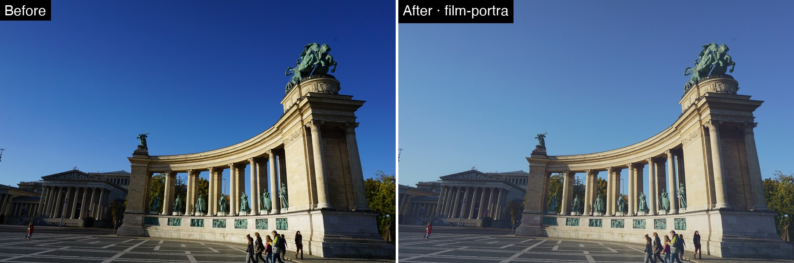

<div align="center">

#  photo-editing-skill

**Give your AI a photographer's eye.**

From a full memory card to a collection worth keeping.<br>
AI-powered culling, Lightroom-style grading, and visual review in one skill.

**13 built-in looks · Visual review and refinement · Full-resolution JPEG + JSON recipes + Lightroom XMP**

[](#get-started)
[](#built-in-styles)
[](#working-with-ai-assistants)
[](#working-with-ai-assistants)
[](#working-with-ai-assistants)
[](#how-it-works)

[English](README.md) · [繁體中文](README.zh-TW.md)

[Get started](#get-started) · [What you can do](#what-you-can-do) · [Example prompts](#example-prompts) · [Results](#results) · [Compatibility](#platform-compatibility)

</div>

photo-editing-skill gives your AI assistant a complete photo-editing workflow: select the strongest shots, correct light and color, develop a consistent look, and inspect the results before delivery.

Use it with **Codex, Claude Code, Gemini CLI**, or another assistant with file, terminal, and image access. The included processing engine runs locally, with grading recipes you can inspect and reuse.


*Original on the left, edited on the right. From a travel collection culled from 1,645 photos to 158 selections.*

## Get started

### Quick install with npx

Install the skill into your assistant's skills folder (needs Node.js; the engine still needs Python 3.9+ and [uv](https://docs.astral.sh/uv/)):

```sh
npx photo-editing-skill            # Claude Code: ~/.claude/skills/photo-edit
npx photo-editing-skill --codex    # Codex:       ~/.codex/skills/photo-edit
npx photo-editing-skill --gemini   # Gemini CLI:  ~/.gemini/skills/photo-edit
npx photo-editing-skill --all      # all three
npx photo-editing-skill --project  # this project only: ./.claude/skills/photo-edit
npx photo-editing-skill pe doctor  # run the engine directly
```

Re-run to update; `npx photo-editing-skill uninstall` removes it. To work from source instead, follow the steps below.

### 1. Set up the local engine

You need **Git, Python 3.9+, and uv**. Run the following in macOS or Linux terminals, or Windows PowerShell:

```sh
git clone https://github.com/yankesswang/photo-editing-skill.git
cd photo-editing-skill
uv run scripts/pe.py doctor
```

`uv` installs the core dependencies automatically. `doctor` reports the platform, paths, and available optional packages without downloading models. Optional features have [additional dependencies](#optional-dependencies); package compatibility may require a newer Python version.

### 2. Choose how to work

**With an AI assistant**

Open this repository in your assistant's workspace, then ask:

```text
Read SKILL.md and use the photo-edit workflow on my photos folder.
Cull the strongest shots, show me a style board, and let me choose a look.
Review the before-and-after previews, refine the edits, and export
full-resolution JPEGs with recipe files. Keep the originals unchanged.
```

Replace `photos` with your actual folder. The assistant follows [SKILL.md](SKILL.md) and adapts the commands to its tools and operating system.

**From the command line**

```sh
uv run scripts/pe.py board "photo.jpg" -o out/board.jpg
uv run scripts/pe.py develop "photo.jpg" --style film-portra -o out/final
uv run scripts/pe.py compare "photo.jpg" "out/final/photo_film-portra.jpg" -o out/compare.jpg
```

Open the style board before choosing a look, then inspect the comparison. Replace `photo.jpg` with your own image and update the output filename in the comparison command accordingly.

| Output | What you get |
| --- | --- |
| `out/board.jpg` | The original image alongside candidate styles |
| `out/final/photo_film-portra.jpg` | The full-resolution edit |
| `out/final/photo_film-portra.recipe.json` | Source information and applied settings |
| `out/compare.jpg` | A before-and-after comparison |

Keep edited files in a separate output directory. Source images are preserved.

## What you can do

| Workflow | Use it when you want to... | Output |
| --- | --- | --- |
| **Cull a shoot** | Find the strongest frames, compare bursts, and flag blur or poor exposure | Ranked selections, contact sheets, and an input list for editing |
| **Develop a collection** | Correct exposure and white balance, then apply a consistent look | Full-resolution JPEGs and per-image recipes |
| **Find your look** | Compare 13 built-in styles or derive settings from a reference image | A style board or a custom JSON recipe |
| **Refine specific areas** | Lift a subject, control a bright sky, or adjust a color range | Local adjustments with mask previews |
| **Retouch portraits** | Make subtle skin, under-eye, teeth, and face-shape adjustments | Retouched images; iPhone mattes or AI semantic mattes for other cameras |
| **Clean up night shots** | Reduce noise in a single image or merge a closely aligned burst | A denoised image ready for grading |
| **Remove bystanders** | Remove distractions using another frame or generated background fill | Edited images with alignment and fill-quality warnings |
| **Organize an album** | Group photos by event and content, then review potential rejects | An HTML report, review lists, and optional categorized folders |
| **Take a look into Lightroom** | Reuse global grading settings in Lightroom Classic or Camera Raw | An XMP preset |

Some workflows require optional packages or platform-specific tools. See [compatibility](#platform-compatibility) and [limitations](#limitations).

## Example prompts

After loading `SKILL.md`, describe the outcome you want:

**Travel collection**

```text
Cull my travel photos in photos/trip. Show me the strongest shots and
compare a few film-inspired looks. Keep the daylight photos consistent,
and use a separate look for night scenes.
```

**Reference-based grading**

```text
Use reference.jpg as the color direction for this set. Preserve natural
skin tones and show me before-and-after previews before the final export.
```

**Portraits**

```text
Give these portraits a clean, natural finish. Keep facial features intact,
use subtle retouching, and show me close-up comparisons of the faces.
```

**Album organization**

```text
Group this folder by event and subject. Flag blurred frames, closed eyes,
and near-duplicates for review. Give me an HTML report without deleting files.
```

**Bystander removal**

```text
Identify the people in this photo and show me their numbered overlays.
Keep the main subject. Check the adjacent burst frames for real background
pixels before using inpainting, then inspect the edited areas at full size.
```

## Results

The examples below come from one trip, photographed as unprocessed Sony a5100 JPEGs. The workflow selected 158 images from 1,645, using `film-portra` for daylight scenes and `night-city` for night scenes, followed by individual adjustments. Originals appear on the left; edits appear on the right.

<details>
<summary>View before-and-after examples</summary>

| Scene | Scene |
| --- | --- |
|  **Foggy lake:** stronger tonal separation while keeping the overcast sky neutral. |  **Autumn foliage:** film-inspired color with atmospheric haze preserved. |
|  **Heroes' Square:** daylight grading with a blue sky. |  **Sunset silhouette:** more sky definition while retaining a dark foreground. |
|  **Prater at night:** deep blue shadows and warm lights. |  **Museum interior:** noise reduction and highlight control in low light. |
|  **Museum specimen:** high-ISO noise reduction and improved definition. | |

</details>

<details>
<summary>View bystander removal and a style comparison board</summary>

Bystander removal uses person segmentation (YOLOv8-seg) plus an effect-aware removal model: [OSOR](https://github.com/Zhouqm-Git/osor) by default on NVIDIA GPUs, [ObjectClear](https://github.com/zjx0101/ObjectClear) on request, and [LaMa](https://github.com/advimman/lama) as the fast fallback. OSOR and ObjectClear also remove the person's shadow and reflection. In this example (LaMa), four visitors were removed. A person in front of the dark doorway was retained because the background structure could not be reconstructed convincingly.


A style board renders multiple looks from the same source image:


</details>

## How it works

```text
Photo folder / memory card
          │
          ▼
     Cull and analyze
          │
          ▼
  Compare styles and choose a look
          │
          ▼
     Render previews
          │
          ▼
  Review images → Refine settings
          │
          ▼
  Full-resolution JPEGs + recipes + optional XMP
```

The Python, NumPy, and OpenCV engine handles image processing. The assistant interprets the scene, evaluates the output, and decides what to adjust.

1. **Correct before styling.** Apply per-image exposure, white balance, tone, and noise corrections before adding a shared look.
2. **Review the actual output.** Inspect comparisons, masks, and detail crops for unnatural skin, gray whites, halos, and artifacts.
3. **Make each revision intentional.** Record the problem, intended improvement, and tradeoff; keep revision rounds bounded and deliver the best reviewed version.
4. **Keep the collection coherent.** Share a look across related scenes and make individual corrections where needed.
5. **Preserve sources and settings.** Keep originals intact and record each edit in a JSON recipe. Album reports recommend deletions without deleting files.

Personal preferences can be recorded in `~/.config/photo-edit/taste.md` and consulted at the start of a session. Detailed review criteria and editing procedures live in [SKILL.md](SKILL.md).

## Working with AI assistants

| Setup | How to use it |
| --- | --- |
| **Codex, Claude Code, Gemini CLI, or another local agent** | Open the repository in an accessible workspace and ask the agent to read `SKILL.md`. |
| **A host with skill installation** | Install the entire project folder using the host's mechanism. Keep `scripts/`, `styles/`, and `references/` alongside `SKILL.md`. |
| **A chat interface without local tools** | Run the CLI yourself and share style boards or comparisons for feedback. |
| **CLI only** | Choose styles, run commands, and review images yourself. |

Full agent operation requires **local file access, command execution, and image viewing**. Host-specific discovery varies; these integrations use the shared workflow and CLI rather than dedicated provider adapters. An assistant that cannot view the output cannot complete visual review.

Use actual mounted paths, such as `"E:/DCIM"` on Windows, `"/media/user/SD/DCIM"` on Linux, or `"/Volumes/SD/DCIM"` on macOS. The [runtime guide](references/runtime-guide.md) covers shell differences, dependencies, and fallback workflows.

Processing runs locally. Any image transfer to a remote model depends on your assistant's host and model settings.

## Platform compatibility

The core CLI uses portable Python libraries. **Core workflows have been tested on Linux. Windows and macOS have not yet been validated on physical machines for the current changes.** Platform guards have automated coverage; optional formats and models require validation in the target environment.

| Capability | Windows | Linux | macOS | Requirements |
| --- | --- | --- | --- | --- |
| JPEG editing, culling, style boards, comparisons, XMP export | Shared CLI | Shared CLI | Shared CLI | Core dependencies |
| RAW decoding | Optional | Optional | Optional | `rawpy`; camera support depends on the decoder |
| HEIC / HEIF decoding | `pillow-heif` | `pillow-heif` | `pillow-heif` or system `sips` | Decoding does not extract iPhone mattes |
| Album classification, portrait retouching, bystander removal | Optional | Optional | Optional | Compatible packages and models; see below |
| Existing iPhone matte sidecars | Shared workflow | Shared workflow | Shared workflow | Matching `<image-stem>.mattes/` directory beside the image |
| Semantic mattes for any camera (`seg-mattes`) | Optional | Optional | Optional | `torch`, `ultralytics`, `mediapipe`; writes the same `<image-stem>.mattes/` layout |
| Extracting iPhone mattes | Unavailable | Unavailable | Available | Apple ImageIO, `swiftc`, and an original containing the auxiliary images |
| Apple Photos access and import | Unavailable | Unavailable | Available | Photos, AppleScript, and system permissions |

On Windows and Linux, use a local photo directory instead of Apple Photos. iPhone mattes can be extracted on a Mac and copied with the matching images. For other cameras, `pe.py seg-mattes` builds person, skin, eye, teeth, and lip mattes with YOLOv8-seg and MediaPipe, so portrait masks and `skin_anchor` work on Sony, Canon, or Android photos too.

### Optional dependencies

Add optional packages to the **same `uv run` invocation** that performs the operation. A package installed with a global `pip` command may not be visible in uv's isolated script environment.

| Capability | Invocation |
| --- | --- |
| RAW decoding | `uv run --with rawpy scripts/pe.py develop "photo.ARW" --style clean-natural -o out/raw` |
| HEIC decoding | `uv run --with pillow-heif scripts/pe.py develop "photo.HEIC" --style clean-natural -o out/heic` |
| Person detection | `uv run --with torch --with ultralytics scripts/pe.py people "photo.jpg" -o out/people.jpg` |
| Person removal with shadows (OSOR / ObjectClear, NVIDIA GPU) | `uv run --with torch --with ultralytics --with diffusers==0.32.2 --with peft==0.14.0 --with transformers --with accelerate scripts/pe.py erase "photo.jpg" --keep 0 -o out/erased` (add `--with scipy` for `--backend objectclear`) |
| Album organization | `uv run --with mediapipe --with torch --with transformers scripts/pe.py organize "photos" -o out/album` |
| Semantic mattes for non-iPhone portraits | `uv run --with torch --with ultralytics --with mediapipe scripts/pe.py seg-mattes "photo.jpg"` |
| Portrait retouching | `uv run --with mediapipe scripts/pe.py develop "photo.jpg" --style vivid-iphone --no-auto -o out/portrait` |

Combine `--with` options when an operation needs several capabilities. For example, person detection on a HEIC image also requires `--with pillow-heif`. Alternatively, install the dependencies in your own virtual environment and invoke `scripts/pe.py` with that environment's Python.

Person removal downloads approximately 220 MB of YOLOv8 and LaMa models on first use; the OSOR / ObjectClear backends additionally download about 7 GB of SDXL-Inpainting fp16 weights plus their own checkpoints (Hugging Face cache) and need an NVIDIA GPU with about 12 GB of VRAM. Album organization additionally uses MediaPipe models and approximately 600 MB of CLIP weights. Download sizes depend on model versions and existing caches.

## CLI reference

Run commands from the repository root. In the examples below, `photos` is the input directory.

### Batch editing

```sh
uv run scripts/pe.py cull "photos" -o out/cull
uv run scripts/pe.py develop "@out/cull/picks.txt" --style film-portra --preview 1200 -o out/preview
uv run scripts/pe.py review "photos" out/preview
uv run scripts/pe.py develop "@out/cull/picks.txt" --style film-portra -o out/final
```

Review the culling sheets and previews before running the final command. Quote `@` file-list arguments for PowerShell compatibility. Add `--consistent` to `develop` to share white-balance and tone corrections within scene groups while retaining per-image exposure adjustments.

### Per-image adjustments

Create a UTF-8 `fixes.json`. Keys can be full filenames or filenames without extensions:

```json
{
  "DSC07550.JPG": {"shadows": -55, "blacks": -20},
  "DSC07047": {"rotate": 90}
}
```

```sh
uv run scripts/pe.py develop "@out/cull/picks.txt" --style film-portra --per-file fixes.json -o out/final
```

UTF-8 input with a byte-order mark is also accepted. In PowerShell, use `Set-Content -Encoding utf8` when writing configuration files. Passing a JSON file avoids differences in shell quoting.

### Additional operations

```sh
# Merge a burst for noise reduction.
uv run scripts/pe.py stack "burst1.jpg" "burst2.jpg" "burst3.jpg" -o out/merged.jpg

# Inspect subject and sky masks.
uv run scripts/pe.py masks "photo.jpg" --mask subject --mask sky -o out/masks.jpg

# Remove people after inspecting their IDs with the people command.
# --backend auto (default) = OSOR on CUDA, else LaMa; also: osor | objectclear | lama
uv run --with torch --with ultralytics --with diffusers==0.32.2 --with peft==0.14.0 --with transformers --with accelerate scripts/pe.py erase "photo.jpg" --keep 0 -o out/erased
uv run --with torch --with ultralytics scripts/pe.py erase "photo.jpg" --keep 0 --backend lama -o out/erased

# Fill from another frame, with LaMa fallback for uncovered regions.
uv run --with torch --with ultralytics scripts/pe.py fill "photo.jpg" --source "burst2.jpg" --keep 0 -o out/filled.jpg

# Derive a look from a reference image.
uv run scripts/pe.py match "photo.jpg" --ref "reference.jpg" -o out/my-look.json

# Export a global preset for Lightroom or Camera Raw.
uv run scripts/pe.py xmp film-portra -o out/film-portra.xmp
```

Use `uv run scripts/pe.py <command> --help` for command options. Inspect the numbered `people` overlay before specifying which people to retain or remove.

## Built-in styles

| Style | Intended use |
| --- | --- |
| `clean-natural` | General-purpose correction with restrained color and contrast |
| `film-portra` | Daylight travel and portraits; warm color and soft highlights |
| `moody-autumn` | Fog, overcast landscapes, and autumn foliage; muted greens and warm highlights |
| `cinematic-teal-orange` | Urban scenes, street photography, and dusk; teal-and-orange grading |
| `muted-chrome` | Architecture and documentary photography; low saturation and defined shadows |
| `bright-airy` | Portraits, cafes, and snow; bright tones and low contrast |
| `bw-fineart` | Architecture and dramatic skies; high-contrast black and white |
| `night-city` | Night scenes, interiors, and high-ISO images; cool shadows and warm lights |
| `nordic-matte` | Minimal landscapes, snow, and coastlines; cool matte tones |
| `golden-hour` | Sunset scenes and portraits; warm golden tones |
| `film-portra-clear` | Daylight travel; Portra-inspired color with blue skies retained |
| `vivid-iphone` | iPhone portraits; vivid backgrounds and subtle retouching; use `--no-auto` |
| `vienna-film` | European streets, architecture, and autumn travel; warm moody film with punchy reds, olive greens, and deep teal skies |

Styles are JSON files in `styles/`. Add your own using the recipe format in the [editing guide](references/editing-guide.md). Global settings can be exported with `pe.py xmp <style>`.

## Limitations

- **Lightroom compatibility:** Controls approximate Lightroom behavior. Identical parameter values do not produce pixel-identical Adobe renders. XMP export includes global adjustments, not local masks or object removal.
- **Input latitude:** JPEGs have limited highlight recovery. RAW decoding offers more latitude but does not apply lens-distortion or lens-vignetting corrections.
- **Masks:** General-purpose subject masks use face anchors, ellipses, and edge refinement rather than semantic person segmentation. Profiles, rear views, and small subjects may need manual boxes, or semantic mattes from `pe.py seg-mattes`. The optional bystander-removal pipeline uses separate YOLOv8 segmentation.
- **Burst merging:** Frames must have closely matching viewpoints. Moving regions fall back to the reference frame; substantial camera or subject movement can eliminate most of the denoising benefit.
- **Culling:** Technical scores compare similar frames. Expressions, timing, and photographic value require visual judgment.
- **Inpainting:** OSOR, ObjectClear and LaMa all generate replacement content. OSOR occasionally removes nearby shadows that belong to the scene (e.g. tree shadows) or leaves part of a shadow; ObjectClear occasionally invents objects in the gap. Kept subjects are protected from the paste. LaMa does not remove shadows. Large subjects and complex structures can produce artifacts. `fill` prefers real pixels from another frame but can also fall back to LaMa. Review results at 100% magnification; avoid generated removal for documentary or identification images.
- **Performance:** Historical author measurements were approximately 15 seconds per 24 MP image and six minutes to cull 1,600 images with caching. Hardware and version details were not recorded, so these are not portable benchmarks.

## Troubleshooting

| Problem | Suggested action |
| --- | --- |
| Missing optional package | Include the required `--with` options and run `doctor` with those same options. |
| HEIC fails on Windows or Linux | Add `--with pillow-heif`, or convert the image to JPEG first. `sips` is macOS-only. |
| Windows cannot create organization symlinks | Use `organize ... --apply copy`, or keep the default report-only mode. Copying uses additional disk space. |
| Assistant cannot open images | Inspect comparisons yourself or use an assistant with image access. The CLI does not perform model-based visual review. |
| Insufficient memory | Start with `--preview 1200`, set `develop -j 1`, and export in smaller batches. |

## Documentation

| Resource | Contents |
| --- | --- |
| [SKILL.md](SKILL.md) | Agent workflow, visual review criteria, and editing procedures |
| [Runtime guide](references/runtime-guide.md) | Platform adaptation, dependencies, tools, and fallback workflows |
| [Editing guide](references/editing-guide.md) | Recipe fields and custom-style authoring |
| [Portability tests](tests/test_portability.py) | Platform guards, text encoding, and a core CLI workflow test |

The detailed workflow and reference guides are currently written primarily in Traditional Chinese.

To run the automated checks:

```sh
uv run --with numpy --with "opencv-python-headless>=4.8,<5" --with pillow python tests/test_portability.py
```

## Acknowledgements

### Models used for person removal

| Model | Role | Licence | Commercial use |
| --- | --- | --- | --- |
| [YOLOv8-seg](https://github.com/ultralytics/ultralytics) (Ultralytics) | Person detection and masks | AGPL-3.0 | Only under AGPL terms or an Ultralytics Enterprise licence |
| [LaMa](https://github.com/advimman/lama) (Samsung AI Center), weights via [simple-lama-inpainting](https://github.com/enesmsahin/simple-lama-inpainting) | Fast fallback inpainting | Apache-2.0 | Yes |
| [OSOR](https://github.com/Zhouqm-Git/osor) — *One-Step Diffusion Inpainting for Effect-Aware Object Removal* ([paper](https://arxiv.org/abs/2606.28094), [weights](https://huggingface.co/QinmingZhou/OSOR)) | Default removal on CUDA, incl. shadows | Code MIT; SDXL weights CreativeML Open RAIL++-M | Yes, within the RAIL++-M use restrictions |
| [ObjectClear](https://github.com/zjx0101/ObjectClear) — *Precise Object and Effect Removal with Adaptive Target-Aware Attention*, CVPR 2026 ([paper](https://arxiv.org/abs/2505.22636), [weights](https://huggingface.co/jixin0101/ObjectClear)) | Optional removal (`--backend objectclear`) | S-Lab License 1.0 | **No — non-commercial only** |
| [SDXL-Inpainting 0.1](https://huggingface.co/diffusers/stable-diffusion-xl-1.0-inpainting-0.1) | Base model of OSOR | CreativeML Open RAIL++-M | Yes, within the use restrictions |

`scripts/removers.py` contains a minimal re-implementation of OSOR's SDXL Phase-II one-step inference (MIT). ObjectClear's code is not bundled; it is cloned from its repository into the model cache on first use. Model weights are downloaded from their original hosts and are not redistributed here. If you use this removal in research, please cite the OSOR and ObjectClear papers.

### Workflow references

The workflow draws on ideas from these projects: [lightroom-style](https://github.com/Wyyyyuu/lightroom-style) for tonal-region color analysis and iteration discipline; [raw-photo-agent](https://github.com/Timverhoogt/raw-photo-agent) for candidate selection and independent review; [photo-skills](https://github.com/konanok/photo-skills) for culling and consistency; [chemigram](https://github.com/chipi/chemigram) for intent-to-adjustment vocabulary and preference files; [muse-skills](https://github.com/GuohongLi/muse-skills) for culling criteria; [computer-use-photo-editing-skills](https://github.com/eamonboyle/computer-use-photo-editing-skills) for grading checks and composition decisions; and [photo-retouch-pro](https://github.com/qzfcoder/photo-retouch-pro) for retouching intensity levels.

These workflow references are methodological; their source code was not copied. All example photographs were taken by the project author.
