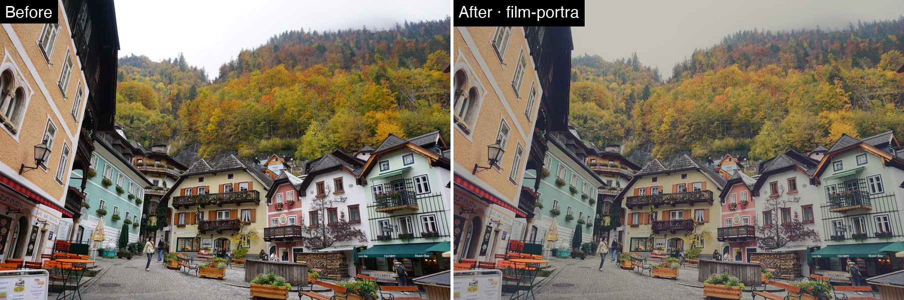
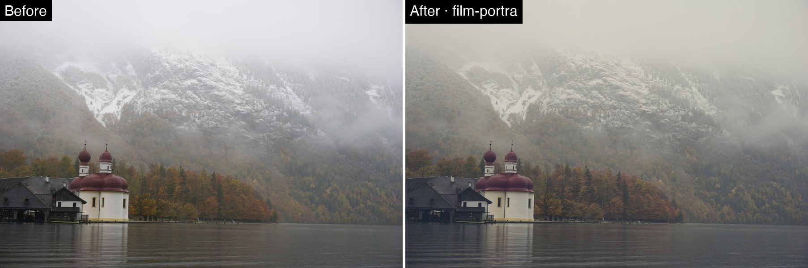
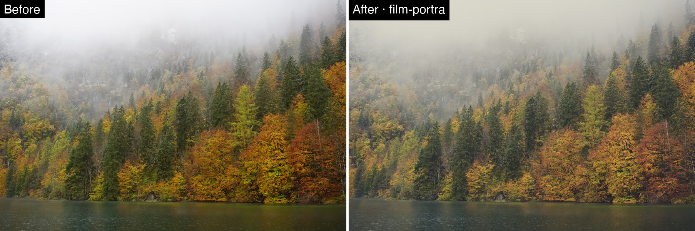
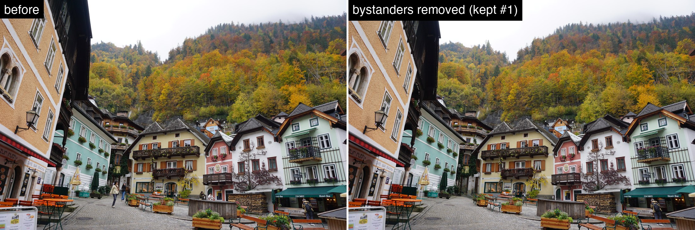

# photo-edit-skill

讓 Claude 像攝影師一樣修照片的 [Claude Code](https://claude.com/claude-code) skill：從一整張 SD 卡選片、逐張校正、套上 Lightroom 式的風格，最後**親眼看前後對照再修正**，輸出全解析度 JPG 和可匯入 Lightroom 的 `.xmp` 預設檔。

A Claude Code skill that culls, corrects and colour-grades your photos like a photographer — a numpy/OpenCV re-implementation of the Lightroom develop panels, driven by Claude's visual judgement.



## 實際效果

以下都是同一趟旅行（Sony a5100 JPG，未經任何前處理）用這個 skill 修出來的成品。左邊原圖、右邊修後。
從 1645 張選出 158 張；白天用 `film-portra`、夜間用 `night-city`，再依場景個別修正。

| | |
|---|---|
|  霧中的國王湖：陰天專用修正（壓黑位、加對比、修掉灰天變米黃） |  霧與秋色：保留空氣感，色彩更有底片味 |
|  英雄廣場：晴天的底片藍天 |  日落剪影：天空層次拉出來，剪影維持黑色 |
|  普拉特夜景：深藍夜空＋乾淨暖光 |  自然史博物館：室內低光降噪、壓住亮部 |
|  博物館標本：高 ISO 降噪與立體感 | |

清除路人（`pe.py erase`）：自動找出畫面裡的每個人並分成主角／路人，路人用 LaMa 補上背景。下圖清掉了廣場上的 4 位遊客，右下角站在深色門口前的那位刻意保留，因為他背後的結構太複雜，補出來會穿幫。



同一張照片套上 10 種風格（`pe.py board`）：


## 它做什麼

| 步驟 | 指令 | 說明 |
|---|---|---|
| 選片 | `pe.py cull` | 依拍攝時間＋外觀相似度把連拍分組；否決模糊（人物照量**臉部**清晰度）、過暗、過曝；組內排名，產出附臉部特寫的總覽圖給 Claude 判斷「瞬間」 |
| 分析 | `pe.py analyze` | 曝光統計、場景標籤（夜景／逆光／霧／人物…）、自動校正建議（中央加權或人臉測光、白平衡、高光陰影、依 ISO 降噪） |
| 選風格 | `pe.py board` | 一張照片套全部風格並排比較 |
| 修圖 | `pe.py develop` | 自動校正 ＋ 風格 ＋ 個別微調，輸出全解析度 JPG＋`.recipe.json`；吃 JPG／HEIC／RAW（ARW、DNG、CR3、NEF…） |
| 整批一致 | `develop --consistent` | 依拍攝時間＋場景分組，組內共用白平衡和影調（曝光仍逐張），同一場景的照片排在一起不會一張暖一張冷 |
| 天空 | recipe 的 `sky` | 救回洗白的天空：壓亮部、漸層、陰天加淡藍；有紋理檢查，白牆／岩石不會被當成天空 |
| 連拍降噪 | `pe.py stack` | 手持連拍對齊（特徵＋ECC＋光流）後加權合併，移動物體自動排除；單張可用 NLM 降噪 |
| 檢查 | `pe.py review` / `compare` | 整批「原圖｜成品」成對總覽，Claude 逐張看、逐張修 |
| 局部調整 | recipe 的 `masks` | 人物、天空、漸層、橢圓、亮度範圍、顏色範圍遮罩（邊緣以 guided filter 貼合）；`pe.py masks` 用紅色疊圖驗證 |
| 清除路人 | `pe.py people` / `erase` | YOLOv8 人物分割找出每個人並編號、猜主角／路人；LaMa 補背景（逐區域、補回顆粒），清完再偵測一次補清殘影；也能寫進 recipe 的 `erase` |
| 多幀補背景 | `pe.py fill` | 有連拍或同場景另一張時，把另一張對齊後拿**真實像素**補路人擋住的地方（局部單應對齊＋色彩匹配），補不到的才用 LaMa |
| 學風格 | `pe.py match` | 從喜歡的攝影師作品推出一組參數（只轉移調色，不轉移內容顏色） |
| 匯出 | `pe.py xmp` | 風格或單張 recipe 匯出成 Lightroom Classic／Camera Raw 預設檔 |

引擎實作的 Lightroom 面板：白平衡、曝光、對比、亮部／陰影／白色／黑色、紋理、清晰度、去朦朧、細節飽和度／飽和度、點曲線（RGB 分色）、8 色 HSL、顏色分級（陰影／中間調／亮部／整體）、黑白混色、銳利化、降噪、暗角、顆粒、旋轉／拉直／裁切、局部遮罩。參數名稱和範圍都對應 Lightroom。

## 內建風格

| 風格 | 適合 |
|---|---|
| `clean-natural` | 任何照片；乾淨、真實、不像套濾鏡 |
| `film-portra` | 人像、旅行、白天；暖色底片、柔和高光、好看的膚色 |
| `moody-autumn` | 霧、陰天、秋天風景；暗調、橄欖綠、暖亮部 |
| `cinematic-teal-orange` | 城市、街拍、黃昏；電影感青橙色調 |
| `muted-chrome` | 街拍、建築、紀實；低飽和、硬朗陰影 |
| `bright-airy` | 人像、咖啡廳、雪景；明亮、低對比、粉嫩 |
| `bw-fineart` | 建築、戲劇性天空；高反差黑白 |
| `night-city` | 夜景、室內、高 ISO；深藍陰影＋暖色燈光 |
| `nordic-matte` | 極簡、雪、海岸；冷調霧面 |
| `golden-hour` | 日落、人像；暖金色光暈 |

風格就是 `styles/*.json`，可以自己加；`pe.py xmp <風格>` 可以帶進 Lightroom 用。

## 安裝

```bash
git clone https://github.com/yankesswang/photo-edit-skill.git
ln -sfn "$PWD/photo-edit-skill" ~/.claude/skills/photo-edit
```

依賴：Python 3.9+、numpy、opencv-python-headless、pillow。RAW 需要 `rawpy`、HEIC 直讀需要 `pillow-heif`（`pip install rawpy pillow-heif`；沒裝 pillow-heif 會自動用 macOS 的 `sips` 轉）。
沒裝的話用 `uv run scripts/pe.py ...`，依賴寫在 PEP 723 header，會自動安裝。

清除路人另外需要 `torch` 和 `ultralytics`（`pip install torch ultralytics`）；兩個模型（YOLOv8s-seg 24MB、LaMa 196MB）第一次使用時自動從官方 GitHub release 下載到 `~/.cache/photo-edit/models/`。

相簿整理（`pe.py organize`：分類＋建議刪除閉眼／失焦／模糊／重複）另外需要 `mediapipe`、`torch`、`transformers`（`pip install mediapipe torch transformers`）；臉部模型（MediaPipe，約 4MB）第一次使用時下載，CLIP（`openai/clip-vit-base-patch32`，約 600MB）走 HuggingFace 快取。

## 使用

在 Claude Code 裡直接說：

> 幫我把 /Volumes/NO NAME/DCIM/103MSDCF 的照片選片並修成攝影師風格

Claude 會依 [SKILL.md](SKILL.md) 的流程：選片 → 分析 → 做風格板讓你挑 → 預覽並逐張檢查 → 個別修正 → 全解析度輸出。原檔不會被修改。

也可以直接用 CLI：

```bash
python3 scripts/pe.py styles                                   # 列出風格
python3 scripts/pe.py cull /path/to/DCIM -o out/cull            # 選片
python3 scripts/pe.py board photo.jpg -o board.jpg              # 風格板
python3 scripts/pe.py develop @out/cull/picks.txt --style film-portra --preview 1200 -o out/preview
python3 scripts/pe.py review /path/to/DCIM out/preview          # 前後對照
python3 scripts/pe.py develop @out/cull/picks.txt --style film-portra --per-file fixes.json -o out/final
python3 scripts/pe.py develop DIR --style film-portra --consistent                     # 同場景共用白平衡／影調
python3 scripts/pe.py develop DSC0001.ARW --style clean-natural                        # RAW 直接修
python3 scripts/pe.py develop IMG.jpg --style clean-natural --adjust '{"sky": {"blue": 40}}'   # 陰天天空
python3 scripts/pe.py stack burst1.jpg burst2.jpg burst3.jpg -o out/merged.jpg         # 夜景連拍疊合降噪
python3 scripts/pe.py masks photo.jpg --mask subject --mask sky # 遮罩疊圖
python3 scripts/pe.py people photo.jpg -o people.jpg            # 人物編號疊圖（綠＝主角、紅＝路人）
python3 scripts/pe.py erase photo.jpg --keep 0 -o out/erased     # 只留 0 號，其他人清掉
python3 scripts/pe.py fill photo.jpg --source burst2.jpg --keep 0 -o out/erased   # 用另一張連拍的真實背景補
python3 scripts/pe.py match photo.jpg --ref ref1.jpg ref2.jpg -o my-look.json
python3 scripts/pe.py xmp film-portra                           # Lightroom 預設檔
```

個別微調檔（`--per-file`）的 key 是檔名：

```json
{
  "DSC07550": {"shadows": -55, "blacks": -20},
  "DSC07047": {"rotate": 90},
  "DSC07480": {"masks": [{"name": "face", "mask": {"type": "subject", "subtract": [{"type": "sky"}]},
                          "adjust": {"exposure": 0.8, "shadows": 20}}]}
}
```

## 設計重點

- **先校正、後風格**：每張照片先做自動校正（曝光、白平衡、高光陰影、降噪），再疊上整批共用的風格。這是攝影師的順序，也讓同一批照片看起來像同一個人修的。
- **Claude 要親眼看**：腳本負責算，判斷交給 Claude。SKILL.md 規定動手前先寫視覺簡報、每次修改寫明「問題 → 預期改善 → 代價」、回合上限、交出最好的版本而不是最後一個，並附上失敗訊號清單（橘色塑膠皮膚、灰掉的白色、遮罩光暈…）。
- **個人審美檔**：`~/.config/photo-edit/taste.md` 累積你的偏好，每次開工先讀。
- **8GB 筆電可跑**：24MP 一張約 15 秒；選片 1600 張約 6 分鐘（有快取）。

## 限制

- 這是 Lightroom 演算法的近似，不是 Adobe 的引擎；同一組數字在 Lightroom 裡會接近，但不會像素級一致。
- JPG 輸入高光救回空間小；有 RAW 就用 RAW。RAW 解碼沒有鏡頭變形／暗角校正。
- 連拍疊合只適合站位不動的連拍；人或相機在動的一系列照片合不起來（會退回單張，不會壞）。
- 人物遮罩是「人臉錨點＋橢圓＋邊緣貼合」，不是 AI 分割；側臉、背影偵測不到時要手動指定框。
- 選片的技術分數只比較同一組裡幾乎一樣的照片；哪些瞬間值得留，靠 Claude 看圖判斷。
- `.xmp` 匯出不含局部遮罩和清除路人。
- 清除路人是在**生成**原本不存在的背景：小路人在石板路、牆面、天空前效果很好；人比較大、背後是門口／招牌／人群時會留下抹痕或殘影，這時應該保留那個人。紀實或證件用途的照片不要用。

## 參考

設計上參考了這些開源專案的方法（沒有複製程式碼）：
[lightroom-style](https://github.com/Wyyyyuu/lightroom-style)（分亮度區色彩量測、回合紀律）、
[raw-photo-agent](https://github.com/Timverhoogt/raw-photo-agent)（候選版本與獨立評審）、
[photo-skills](https://github.com/konanok/photo-skills)（選片與一致性模式）、
[chemigram](https://github.com/chipi/chemigram)（意圖 → 動作詞彙、taste 檔）、
[muse-skills](https://github.com/GuohongLi/muse-skills)（選片評分維度、畫質標準）、
[computer-use-photo-editing-skills](https://github.com/eamonboyle/computer-use-photo-editing-skills)（調色失敗訊號、構圖決策）、
[photo-retouch-pro](https://github.com/qzfcoder/photo-retouch-pro)（強度分級）。

範例照片為作者本人拍攝。
