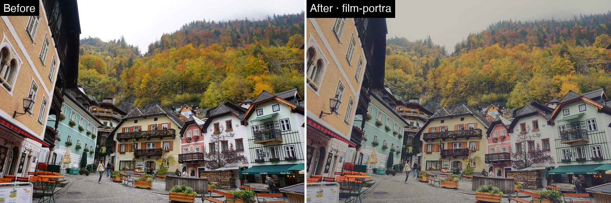
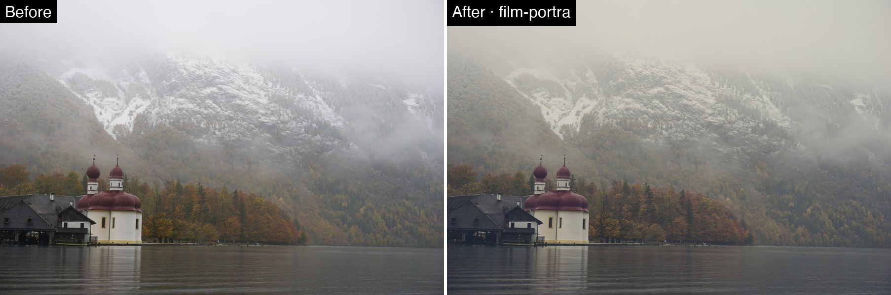
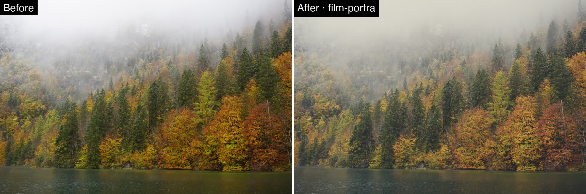
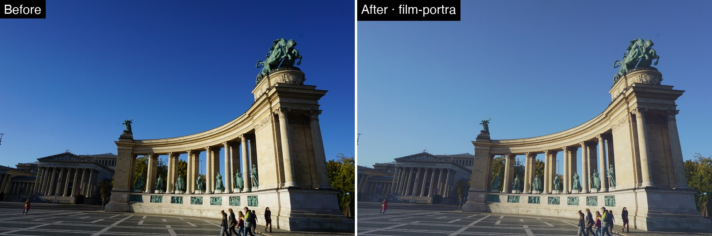
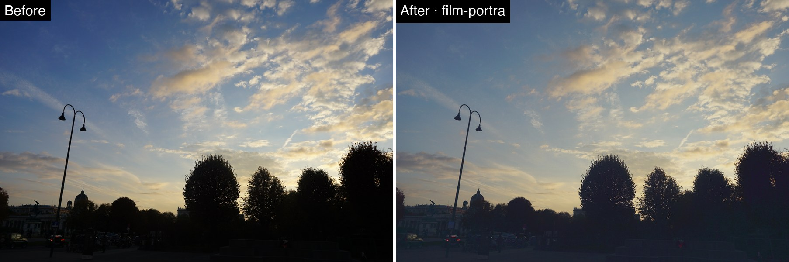
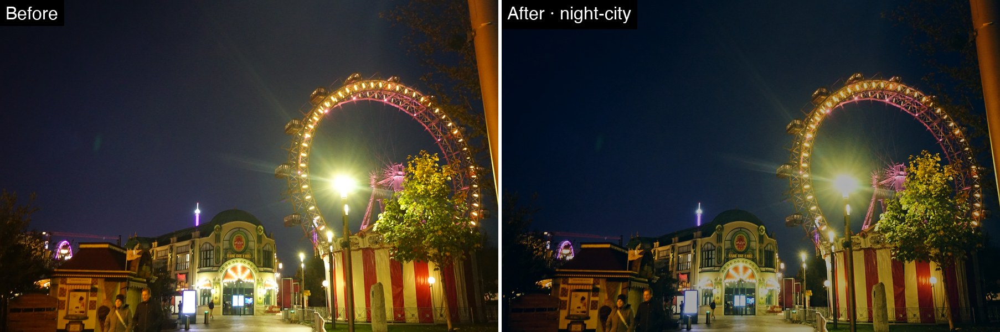
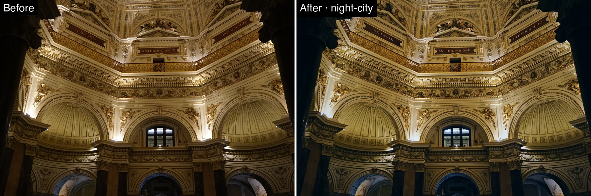
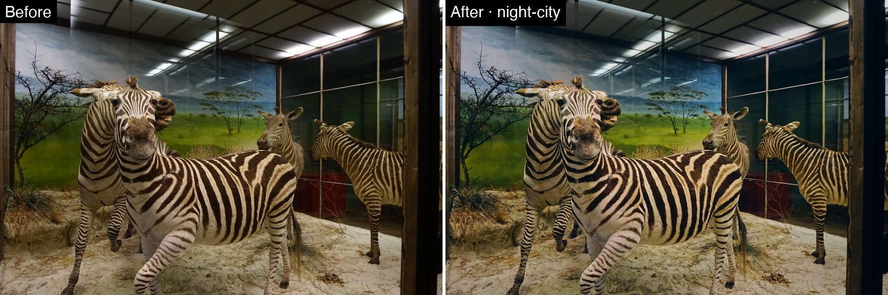
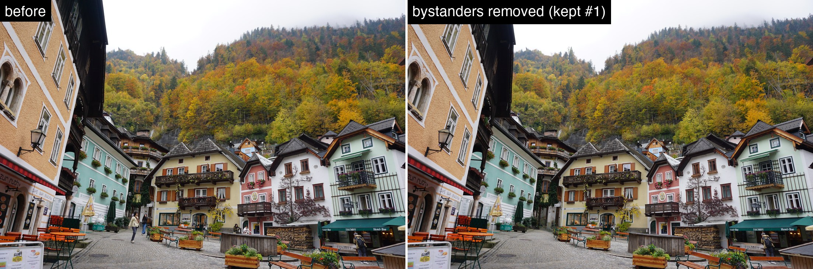
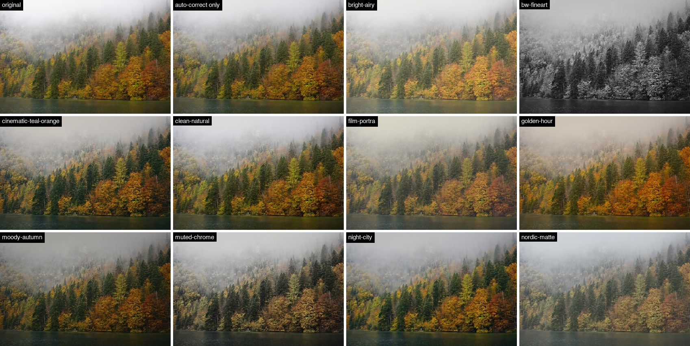

<div align="center">

#  photo-edit-skill

**讓你的 AI，擁有攝影師的眼光。**

從一整張記憶卡，到值得珍藏的作品集。<br>
選片、Lightroom 風格調色、看圖檢查，一個 Skill 完成整套修圖流程。

**12 種內建風格 · 看圖檢查與修正 · 全解析度 JPEG + JSON 參數檔 + Lightroom XMP**

[](#快速開始)
[](#內建風格)
[](#搭配-ai-助理)
[](#搭配-ai-助理)
[](#搭配-ai-助理)
[](#運作流程)

[English](README.md) · [繁體中文](README.zh-TW.md)

[快速開始](#快速開始) · [功能一覽](#功能一覽) · [提示詞範例](#提示詞範例) · [實際效果](#實際效果) · [平台相容性](#平台相容性)

</div>

photo-edit-skill 為 AI 助理提供完整的修圖流程：挑出精彩瞬間、校正光線與色彩、建立整組一致的風格，並在交件前實際檢查成品。

可搭配 **Codex、Claude Code、Gemini CLI**，或其他能讀取檔案、執行命令與檢視圖片的 AI 助理。內建影像引擎在本機運作，調色設定以參數檔保存，方便檢查與重複使用。



*左側原圖，右側修後。來自一組從 1,645 張照片中選出 158 張的旅行作品。*

## 快速開始

### 1. 設定本機環境

準備好 **Git、Python 3.9+ 與 uv**，在 macOS／Linux 終端機或 Windows PowerShell 執行：

```sh
git clone https://github.com/yankesswang/photo-edit-skill.git
cd photo-edit-skill
uv run scripts/pe.py doctor
```

`uv` 會自動安裝核心依賴。`doctor` 列出作業系統、路徑與選配套件是否存在，不會下載模型。進階功能需要[額外依賴](#選配依賴)，部分套件可能要求較新的 Python 版本。

### 2. 選擇使用方式

**交給 AI 助理**

在助理的工作區開啟本專案，然後提出需求：

```text
先讀取 SKILL.md，依照 photo-edit 流程處理我的 photos 資料夾。
幫我挑出最好的照片，做一張風格板讓我選擇。
檢查修圖前後的預覽，修正有問題的地方，最後輸出全解析度 JPEG 與參數檔。
保留原檔，不要覆寫。
```

將 `photos` 換成實際照片資料夾。助理會依 [SKILL.md](SKILL.md) 的流程，配合目前的工具與作業系統調整指令。

**直接使用命令列**

```sh
uv run scripts/pe.py board "photo.jpg" -o out/board.jpg
uv run scripts/pe.py develop "photo.jpg" --style film-portra -o out/final
uv run scripts/pe.py compare "photo.jpg" "out/final/photo_film-portra.jpg" -o out/compare.jpg
```

先開啟風格板挑選風格，再檢查前後對照。請將 `photo.jpg` 換成自己的照片；更換檔名或風格後，對照指令中的成品檔名也要跟著修改。

| 輸出 | 內容 |
| --- | --- |
| `out/board.jpg` | 原圖與多種候選風格 |
| `out/final/photo_film-portra.jpg` | 全解析度修圖成品 |
| `out/final/photo_film-portra.recipe.json` | 來源資訊與實際套用的設定 |
| `out/compare.jpg` | 修圖前後對照 |

請使用獨立的輸出資料夾保存成品，保留來源照片。

## 功能一覽

| 工作流程 | 適合這些需求 | 交付成果 |
| --- | --- | --- |
| **選片** | 挑出精彩瞬間、比較連拍、標記模糊與曝光不佳的照片 | 排序後的入選照片、總覽圖與修圖清單 |
| **整批調色** | 校正曝光與白平衡，建立一致的整組風格 | 全解析度 JPEG 與逐張參數檔 |
| **尋找風格** | 比較 12 種內建風格，或從參考圖推導調色設定 | 風格板或自訂 JSON 參數檔 |
| **局部調整** | 提亮主體、壓住過亮天空、調整特定顏色 | 局部修正與遮罩預覽 |
| **人像修飾** | 輕微調整膚質、黑眼圈、牙齒與臉部輪廓 | 人像成品；可搭配 iPhone 原生遮罩 |
| **夜景降噪** | 處理單張雜訊，或合併構圖接近的連拍 | 可接續調色的低雜訊影像 |
| **清除路人** | 用另一張照片的背景，或生成式補圖移除干擾 | 處理後照片，以及對齊與補圖品質警告 |
| **相簿整理** | 按活動與內容分類，審查可能不需要的照片 | HTML 報告、待確認清單與選配分類資料夾 |
| **帶進 Lightroom** | 在 Lightroom Classic／Camera Raw 重用全域調色設定 | XMP 預設檔 |

部分功能需要選配套件或平台專屬工具，詳見[平台相容性](#平台相容性)與[限制](#限制)。

## 提示詞範例

載入 `SKILL.md` 後，直接描述你想要的結果：

**旅行照片**

```text
幫我選 photos/trip 裡的旅行照片，挑出最好的幾張，
再比較幾種底片風格。白天照片維持一致，夜景另外用適合的風格。
```

**參考圖調色**

```text
以 reference.jpg 作為這組照片的色彩方向，保留自然膚色。
最終輸出前先給我看修圖前後的預覽。
```

**人像修飾**

```text
把這組人像修得乾淨自然，保留原本五官，只做輕微修飾。
請提供臉部放大的前後對照。
```

**相簿整理**

```text
將這個資料夾按活動與主題分類，標記模糊、閉眼與近似重複的照片供我確認。
給我一份 HTML 報告，不要刪除檔案。
```

**清除路人**

```text
找出這張照片裡的人，先給我看人物編號疊圖，保留主角。
補圖前先檢查前後連拍是否有可用的真實背景，最後用原尺寸檢查修補區域。
```

## 實際效果

以下範例來自同一趟旅行，以 Sony a5100 拍攝的 JPEG 為輸入，未經額外前處理。從 1,645 張選出 158 張，白天使用 `film-portra`、夜景使用 `night-city`，再逐張微調。左側為原圖，右側為成品。

<details>
<summary>展開修圖前後對照</summary>

| 場景 | 場景 |
| --- | --- |
|  **霧中湖景：** 加強影調分離，維持陰天天空的中性色。 |  **霧與秋色：** 加入底片色彩，保留空氣感。 |
|  **英雄廣場：** 晴天調色，保留藍天。 |  **日落剪影：** 拉出天空層次，保持前景剪影。 |
|  **普拉特夜景：** 深藍陰影搭配暖色燈光。 |  **博物館室內：** 低光降噪與亮部控制。 |
|  **博物館標本：** 高 ISO 降噪與細節層次。 | |

</details>

<details>
<summary>展開清除路人範例與風格板</summary>

清除路人使用人物分割（YOLOv8-seg）加上能處理陰影的移除模型：NVIDIA GPU 上預設使用 [OSOR](https://github.com/Zhouqm-Git/osor)，可選用 [ObjectClear](https://github.com/zjx0101/ObjectClear)，並以 [LaMa](https://github.com/advimman/lama) 作為快速備援。OSOR 與 ObjectClear 會連同人物的影子與倒影一起移除。這個範例（LaMa）移除了四名遊客，但保留站在深色門口前的人，因為其背後的結構無法自然重建。



風格板將同一張照片以多種風格並排呈現：



</details>

## 運作流程

```text
照片資料夾／記憶卡
        │
        ▼
    選片與分析
        │
        ▼
  比較風格並選擇方向
        │
        ▼
     輸出預覽
        │
        ▼
  看圖檢查 → 修正參數
        │
        ▼
  全解析度 JPEG + 參數檔 + 選配 XMP
```

Python、NumPy 與 OpenCV 引擎負責影像處理；AI 助理負責理解場景、評估結果與決定調整方向。

1. **先校正，再套風格。** 逐張修正曝光、白平衡、影調與雜訊，再加入整組共用的風格。
2. **實際檢查成品。** 查看前後對照、遮罩與細節裁切，找出不自然膚色、灰白、光暈與修補痕跡。
3. **每次修改都有理由。** 記錄問題、預期改善與代價，限制修改回合，交付檢查過的最佳版本。
4. **保持整組一致。** 相近場景共用風格，必要時逐張修正。
5. **保留原檔與設定。** 原圖不動，調整記錄在 JSON 參數檔；相簿報告只提供刪除建議，不會刪檔。

個人偏好可記錄於 `~/.config/photo-edit/taste.md`，每次開工先讀取。完整的視覺檢查標準與修圖步驟見 [SKILL.md](SKILL.md)。

## 搭配 AI 助理

| 使用環境 | 接入方式 |
| --- | --- |
| **Codex、Claude Code、Gemini CLI 或其他本機助理** | 在助理可存取的工作區開啟本專案，要求先讀 `SKILL.md`。 |
| **支援安裝 skill 的宿主** | 依宿主機制安裝完整專案資料夾，保留與 `SKILL.md` 同層的 `scripts/`、`styles/`、`references/`。 |
| **無法操作本機工具的聊天介面** | 自行執行 CLI，提供風格板或對照圖討論調整方向。 |
| **純 CLI** | 自行選風格、執行命令與檢查成品。 |

完整操作需要**本機檔案讀取、命令執行與圖片檢視能力**。各宿主的 skill 發現方式不同，目前採共用流程文件與 CLI 接入，未針對每家模型提供獨立轉接器。無法看圖的助理不能完成視覺驗收。

請使用實際掛載路徑，例如 Windows `"E:/DCIM"`、Linux `"/media/user/SD/DCIM"`、macOS `"/Volumes/SD/DCIM"`。Shell 差異、依賴與替代流程見[執行環境指南](references/runtime-guide.md)。

影像引擎在本機執行。圖片是否傳送至遠端模型，依助理的宿主與模型設定而定。

## 平台相容性

核心 CLI 使用可攜的 Python 套件。**核心流程已在 Linux 測試；目前這批跨平台修改尚未於 Windows／macOS 實機驗證。** 平台判斷已有自動化測試，選配格式與模型仍需在目標環境確認。

| 功能 | Windows | Linux | macOS | 需求 |
| --- | --- | --- | --- | --- |
| JPEG 調色、選片、風格板、對照與 XMP 輸出 | 共用 CLI | 共用 CLI | 共用 CLI | 核心依賴 |
| RAW 解碼 | 選配 | 選配 | 選配 | `rawpy`；相機格式支援由解碼器決定 |
| HEIC／HEIF 解碼 | `pillow-heif` | `pillow-heif` | `pillow-heif` 或系統 `sips` | 讀取影像不等於抽取 iPhone 遮罩 |
| 相簿分類、人像修飾、清除路人 | 選配 | 選配 | 選配 | 相容的套件與模型，詳見下方 |
| 使用既有 iPhone 遮罩附屬檔 | 共用流程 | 共用流程 | 共用流程 | 照片旁須有同名 `<image-stem>.mattes/` 資料夾 |
| 抽取 iPhone 遮罩 | 不提供 | 不提供 | 提供 | Apple ImageIO、`swiftc`，且原檔須含輔助影像 |
| 存取／匯入 Apple「照片」App | 不提供 | 不提供 | 提供 | 照片 App、AppleScript 與系統權限 |

Windows／Linux 使用一般照片資料夾取代 Apple「照片」App。iPhone 遮罩可先在 Mac 抽取，再與對應照片一起複製；也可改用引擎的一般遮罩。

### 選配依賴

請在**執行功能的同一條 `uv run` 命令**加入選配套件。全域 `pip` 安裝的套件不一定存在於 uv 的隔離環境。

| 功能 | 指令範例 |
| --- | --- |
| RAW 解碼 | `uv run --with rawpy scripts/pe.py develop "photo.ARW" --style clean-natural -o out/raw` |
| HEIC 解碼 | `uv run --with pillow-heif scripts/pe.py develop "photo.HEIC" --style clean-natural -o out/heic` |
| 人物偵測 | `uv run --with torch --with ultralytics scripts/pe.py people "photo.jpg" -o out/people.jpg` |
| 連同影子清除路人（OSOR／ObjectClear，需 NVIDIA GPU） | `uv run --with torch --with ultralytics --with diffusers==0.32.2 --with peft==0.14.0 --with transformers --with accelerate scripts/pe.py erase "photo.jpg" --keep 0 -o out/erased`（使用 `--backend objectclear` 時另加 `--with scipy`） |
| 相簿整理 | `uv run --with mediapipe --with torch --with transformers scripts/pe.py organize "photos" -o out/album` |
| 人像修飾 | `uv run --with mediapipe scripts/pe.py develop "photo.jpg" --style vivid-iphone --no-auto -o out/portrait` |

複合功能可同時加入多個 `--with`。例如在 HEIC 照片偵測人物，還需要 `--with pillow-heif`。也可自行建立虛擬環境、安裝依賴，再用該環境的 Python 執行 `scripts/pe.py`。

清除路人首次使用會下載約 220 MB 的 YOLOv8 與 LaMa 模型；OSOR／ObjectClear 另需下載約 7 GB 的 SDXL-Inpainting fp16 權重與各自的檢查點（存於 Hugging Face 快取），並需要約 12 GB 顯存的 NVIDIA GPU；相簿整理另使用 MediaPipe 模型與約 600 MB 的 CLIP 權重。實際下載量依模型版本與快取而定。

## CLI 指令參考

請在專案根目錄執行，以下的 `photos` 代表輸入資料夾。

### 批次修圖

```sh
uv run scripts/pe.py cull "photos" -o out/cull
uv run scripts/pe.py develop "@out/cull/picks.txt" --style film-portra --preview 1200 -o out/preview
uv run scripts/pe.py review "photos" out/preview
uv run scripts/pe.py develop "@out/cull/picks.txt" --style film-portra -o out/final
```

執行最後一行前，先檢查選片總覽與預覽。`@` 清單參數加上引號以相容 PowerShell。需要同場景共用白平衡與影調修正時，在 `develop` 加上 `--consistent`；曝光仍會逐張調整。

### 逐張微調

建立 UTF-8 的 `fixes.json`，key 可用完整檔名或不含副檔名的名稱：

```json
{
  "DSC07550.JPG": {"shadows": -55, "blacks": -20},
  "DSC07047": {"rotate": 90}
}
```

```sh
uv run scripts/pe.py develop "@out/cull/picks.txt" --style film-portra --per-file fixes.json -o out/final
```

輸入也接受含位元組順序記號（BOM）的 UTF-8。PowerShell 可使用 `Set-Content -Encoding utf8` 寫入設定檔。傳入 JSON 檔案可避免不同 shell 的引號差異。

### 更多操作

```sh
# 合併連拍以降低雜訊。
uv run scripts/pe.py stack "burst1.jpg" "burst2.jpg" "burst3.jpg" -o out/merged.jpg

# 檢查主體與天空遮罩。
uv run scripts/pe.py masks "photo.jpg" --mask subject --mask sky -o out/masks.jpg

# 先用 people 確認人物編號，再指定保留對象。
# --backend auto（預設）= 有 CUDA 用 OSOR，否則 LaMa；也可指定 osor | objectclear | lama
uv run --with torch --with ultralytics --with diffusers==0.32.2 --with peft==0.14.0 --with transformers --with accelerate scripts/pe.py erase "photo.jpg" --keep 0 -o out/erased
uv run --with torch --with ultralytics scripts/pe.py erase "photo.jpg" --keep 0 --backend lama -o out/erased

# 優先使用另一張照片的背景，不足區域回退至 LaMa。
uv run --with torch --with ultralytics scripts/pe.py fill "photo.jpg" --source "burst2.jpg" --keep 0 -o out/filled.jpg

# 從參考照片推導調色設定。
uv run scripts/pe.py match "photo.jpg" --ref "reference.jpg" -o out/my-look.json

# 匯出 Lightroom 或 Camera Raw 全域預設檔。
uv run scripts/pe.py xmp film-portra -o out/film-portra.xmp
```

使用 `uv run scripts/pe.py <command> --help` 查看選項。指定要保留或清除的人之前，先檢查 `people` 輸出的人物編號疊圖。

## 內建風格

| 風格 | 適合用途 |
| --- | --- |
| `clean-natural` | 通用校正，色彩與對比克制自然 |
| `film-portra` | 白天旅行與人像，暖色與柔和高光 |
| `moody-autumn` | 霧、陰天風景與秋色，低飽和綠色與暖亮部 |
| `cinematic-teal-orange` | 城市、街拍與黃昏，電影感青橙色調 |
| `muted-chrome` | 建築與紀實，低飽和與明確陰影 |
| `bright-airy` | 人像、咖啡廳與雪景，明亮低對比 |
| `bw-fineart` | 建築與戲劇性天空，高對比黑白 |
| `night-city` | 夜景、室內與高 ISO，冷陰影與暖燈光 |
| `nordic-matte` | 極簡風景、雪地與海岸，冷調霧面 |
| `golden-hour` | 日落與人像，暖金色影調 |
| `film-portra-clear` | 晴天旅行，保留藍天的 Portra 風格 |
| `vivid-iphone` | iPhone 人像，鮮豔背景與輕微修飾；搭配 `--no-auto` |

風格以 JSON 檔存放於 `styles/`，可依[調整參數指南](references/editing-guide.md)新增。全域設定可用 `pe.py xmp <style>` 匯出。

## 限制

- **Lightroom 相容性：** 控制項近似 Lightroom 行為，相同數值不保證與 Adobe 引擎產生逐像素一致的結果。XMP 只匯出全域設定，不包含局部遮罩與物件清除。
- **輸入寬容度：** JPEG 的高光救回空間有限。RAW 有較大的調整空間，但解碼不包含鏡頭變形與暗角校正。
- **遮罩：** 一般主體遮罩使用人臉錨點、橢圓與邊緣貼合，不是語意人物分割；側臉、背影與小主體可能需要手動框選。選配的路人清除流程另使用 YOLOv8 分割。
- **連拍合併：** 照片視角必須接近，移動區域會退回參考張；相機或主體大幅移動時，降噪效果可能很有限。
- **選片：** 技術分數只用於比較相似照片，表情、瞬間與作品價值仍需看圖判斷。
- **生成式補圖：** OSOR、ObjectClear 與 LaMa 都會生成替代內容。OSOR 偶爾會連帶抹掉屬於場景的影子（例如樹影）或留下部分影子；ObjectClear 偶爾會在空缺處生出不存在的物件。保留的主體不會被覆蓋。LaMa 不會移除影子，大面積人物與複雜結構可能出現瑕疵。`fill` 優先使用其他照片的真實像素，但仍可能回退至 LaMa。應以 100% 放大檢查；紀實或證件用途避免使用生成式移除。
- **效能：** 原作者歷史紀錄約為每張 24 MP 照片 15 秒、1,600 張照片選片約六分鐘（含快取）。未記錄完整硬體與版本資訊，不應視為跨平台效能基準。

## 疑難排解

| 問題 | 建議處理 |
| --- | --- |
| 缺少選配套件 | 加入所需 `--with`，並用相同選項執行 `doctor`。 |
| Windows／Linux 無法讀取 HEIC | 加上 `--with pillow-heif`，或先轉成 JPEG；`sips` 僅限 macOS。 |
| Windows 無法建立分類符號連結 | 改用 `organize ... --apply copy`，或保留預設的報告模式；複製會增加磁碟用量。 |
| 助理無法開啟圖片 | 自行檢查對照圖，或改用具圖片能力的助理；CLI 不會自動呼叫模型進行視覺審查。 |
| 記憶體不足 | 先用 `--preview 1200`，將 `develop` 設為 `-j 1`，再分批輸出全解析度。 |

## 文件與測試

| 資源 | 內容 |
| --- | --- |
| [SKILL.md](SKILL.md) | AI 工作流程、視覺檢查標準與修圖步驟 |
| [執行環境指南](references/runtime-guide.md) | 平台適配、依賴、工具與替代流程 |
| [調整參數指南](references/editing-guide.md) | 參數欄位與自訂風格 |
| [跨平台測試](tests/test_portability.py) | 平台判斷、文字編碼與核心 CLI 流程測試 |

完整流程與參考指南目前主要以繁體中文撰寫。

執行自動化測試：

```sh
uv run --with numpy --with "opencv-python-headless>=4.8,<5" --with pillow python tests/test_portability.py
```

## 致謝

### 清除路人使用的模型

| 模型 | 用途 | 授權 | 商用 |
| --- | --- | --- | --- |
| [YOLOv8-seg](https://github.com/ultralytics/ultralytics)（Ultralytics） | 人物偵測與遮罩 | AGPL-3.0 | 須遵守 AGPL 或購買 Ultralytics Enterprise 授權 |
| [LaMa](https://github.com/advimman/lama)（Samsung AI Center），權重取自 [simple-lama-inpainting](https://github.com/enesmsahin/simple-lama-inpainting) | 快速備援補圖 | Apache-2.0 | 可 |
| [OSOR](https://github.com/Zhouqm-Git/osor)——*One-Step Diffusion Inpainting for Effect-Aware Object Removal*（[論文](https://arxiv.org/abs/2606.28094)、[權重](https://huggingface.co/QinmingZhou/OSOR)） | CUDA 預設移除模型，含影子 | 程式碼 MIT；SDXL 權重 CreativeML Open RAIL++-M | 可，須遵守 RAIL++-M 使用限制 |
| [ObjectClear](https://github.com/zjx0101/ObjectClear)——*Precise Object and Effect Removal with Adaptive Target-Aware Attention*，CVPR 2026（[論文](https://arxiv.org/abs/2505.22636)、[權重](https://huggingface.co/jixin0101/ObjectClear)） | 選用移除模型（`--backend objectclear`） | S-Lab License 1.0 | **不可，僅限非商用** |
| [SDXL-Inpainting 0.1](https://huggingface.co/diffusers/stable-diffusion-xl-1.0-inpainting-0.1) | OSOR 的基礎模型 | CreativeML Open RAIL++-M | 可，須遵守使用限制 |

`scripts/removers.py` 包含 OSOR SDXL Phase-II 單步推論的精簡重新實作（MIT）。ObjectClear 的程式碼未隨附，首次使用時才從其 repo 下載到模型快取。模型權重皆從原始來源下載，本專案不重新散布。若用於研究，請引用 OSOR 與 ObjectClear 論文。

### 工作流程參考

工作流程參考以下專案的方法：[lightroom-style](https://github.com/Wyyyyuu/lightroom-style) 的亮度分區色彩分析與回合紀律；[raw-photo-agent](https://github.com/Timverhoogt/raw-photo-agent) 的候選版本與獨立評審；[photo-skills](https://github.com/konanok/photo-skills) 的選片與一致性；[chemigram](https://github.com/chipi/chemigram) 的意圖與調整詞彙、偏好檔；[muse-skills](https://github.com/GuohongLi/muse-skills) 的選片標準；[computer-use-photo-editing-skills](https://github.com/eamonboyle/computer-use-photo-editing-skills) 的調色檢查與構圖決策；以及 [photo-retouch-pro](https://github.com/qzfcoder/photo-retouch-pro) 的修飾強度分級。

以上工作流程參考僅為方法參考，未複製其原始碼。所有範例照片皆由專案作者拍攝。
